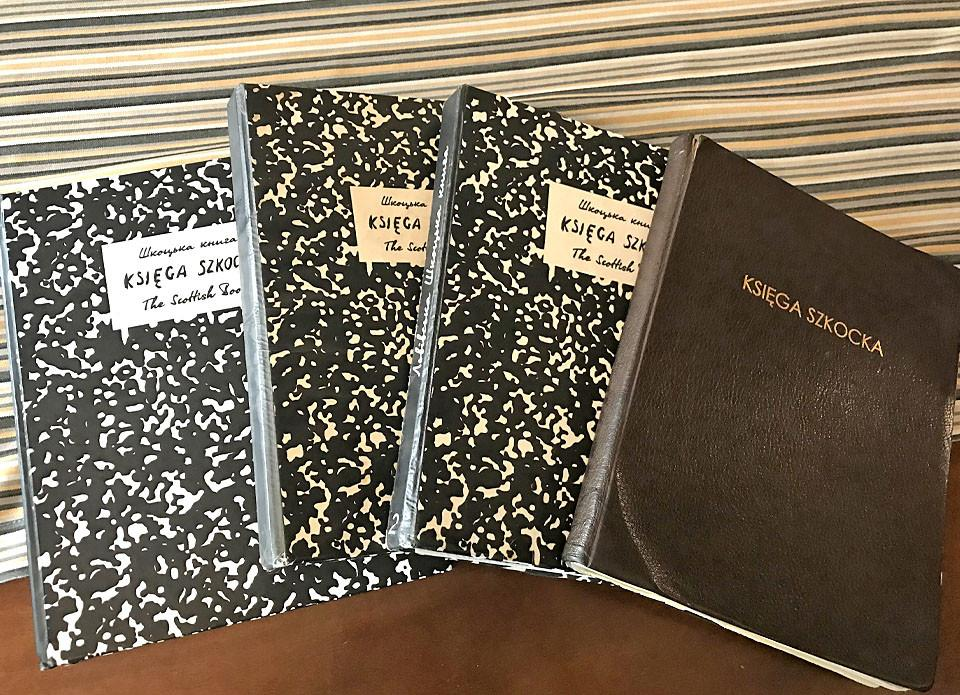
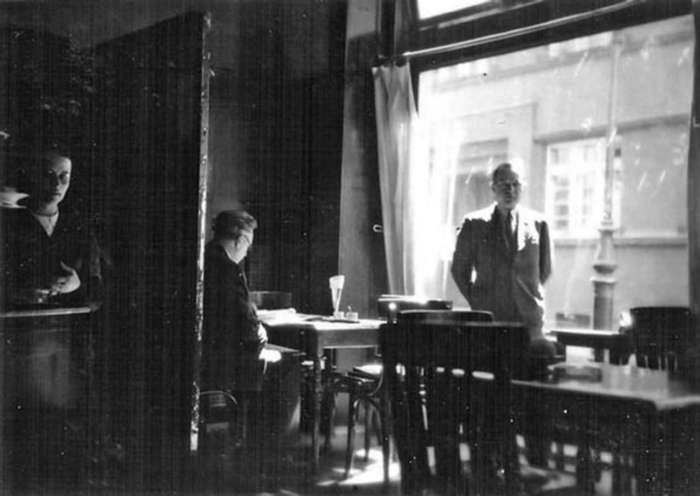

# The Scottish Book

  

<small>The Scottish Book. <a href="assets/README.md">Image provenance and reuse information</a>.</small>

*An independent, collaborative mathematical notebook inspired by the Scottish Café of Lwów.*

**Can humans and AI systems collaborate to formulate new mathematical problems of lasting significance?** This collection explores that question through precise formulations, prior-art comparison, independent criticism, proofs, counterexamples and reproducible computation.

The [Scottish Book](https://link.springer.com/book/10.1007/978-3-319-22897-6), kept at the Scottish Café in Lwów beginning in 1935, recorded mathematical questions and occasionally offered prizes for solutions. This contemporary collection follows its tradition of accessible, collaborative problem formulation. It is independent of the original historical notebook and its successors.

Many entries were developed through **human–AI collaboration**. Mathematical validity and historical priority must be assessed independently of provenance. Human-only contributions are equally welcome. See [provenance and credit](PROVENANCE.md). **Contributions are welcome.**

**[Propose a problem with a simple form](https://github.com/gsidoine/the-scottish-book/issues/new?template=propose-problem.yml)** · [Browse the searchable book](https://gsidoine.github.io/the-scottish-book/) · [Contribute a proof or correction](CONTRIBUTING.md) · [Symbolic rewards](REWARDS.md)

The collection also retains a historical encouragement to problem formulation:

> “The purpose of life is to prove and to conjecture.” — Paul Erdős ([MacTutor, University of St Andrews](https://mathshistory.st-andrews.ac.uk/Biographies/Erdos/quotations/))

This collection currently contains **46 numbered research entries (P001–P046)**. New proposals do not receive a permanent identifier until reviewed.

## Catalogue

[Complete numbered catalogue](#problem-catalogue) · [Mathematical status](#status-and-scope) · [Historical prizes](REWARDS.md) · [Contributions](CONTRIBUTING.md)

The catalogue contains all numbered entries in a single sequence. Mathematical formulation and the assessment of historical novelty are recorded separately. A reward, where specified, is a symbolic designation with an explicit condition; it does not measure difficulty, originality, or importance.

## Status and scope

| Status | Entries | Meaning |
|---|---:|---|
| Candidate | 42 | Research question under investigation; novelty and unresolved status are not certified |
| Reframe | 2 (P007, P025) | A known predecessor requires the remaining question to be narrowed |
| Needs specification | 1 (P008) | The open objective requires a sharper formulation |
| Proved internally | 1 (P010) | A complete proof is supplied; external review and historical priority remain separate |

Computational verification establishes only the stated finite cases. An internal proof is not a claim of verified historical novelty. The full collection is open to mathematical corrections and independent assessments.

## Symbolic rewards

The original Scottish Book included prizes associated with particular questions, including prizes depending on the kind of solution. This collection adopts a [historically documented reward vocabulary](REWARDS.md), without a scale of difficulty or prestige. All rewards are symbolic unless independently and explicitly pledged by a sponsor; **no physical prize is presently offered**. A dash in the catalogue denotes no assigned reward.

## Manuscript record

**[P010 — Minimum coprime adjacencies](problems/graph-theory/P010-minimum-coprime-adjacencies.md)** has a complete internally checked proof. The [submitted manuscript](manuscripts/P010/coprime_adjacencies.pdf) was submitted to the journal _Integers_; submission does not imply acceptance or publication. The archived PDF, the accompanying manuscript record, and its factual AI-use statement are preserved. The journal [permits supporting AI-tool use](https://math.colgate.edu/~integers/submit.html), subject to its stated rules.

## Problem folders

Problems gradually receive a compact public page and their own proofs, exploration, references, verification and optional Lean files. The first two examples are [P015](problems/P015-odd-area-triangulations/README.md) and [P020](problems/P020-padic-hankel-cokernels/README.md). Historical dossier URLs and existing theorem/certificate links remain available during migration.

A contributor may [submit a proposed problem](https://github.com/gsidoine/the-scottish-book/issues/new?template=propose-problem.yml) using Markdown or TeX, select a mathematical field, describe sources and AI involvement, and suggest an optional symbolic reward. A moderator can convert an issue into a draft PR; proposals are not automatically admitted to the book.

## Historical inspiration

  

Stefan Banach was one of the mathematicians associated with the Scottish Café in Lwów, where mathematical problems were recorded in a shared notebook. This contemporary collection takes its name from that tradition; it is not an edition of the original book or its official continuation. See [the historical Scottish Book](https://link.springer.com/book/10.1007/978-3-319-22897-6) and the [image provenance notes](assets/README.md).

## Literature and verification

### Historical source reviews

The [P001–P020 consolidation](audits/2026-10-29-P001-P020-first-collection-consolidation.md), [P001–P025 literature gate](audits/2026-10-29-P001-P025-literature-source-gate.md), and [P001–P030 portfolio consolidation](audits/portfolio-consolidation-P001-P030.md) are historical audits, not the current curation. Their mathematical and bibliographic conclusions are retained as research records.

The [P001–P041 literature comparison](audits/literature-comparison-P001-P041.md) is a historical review, not a current certification of the full catalogue. Individual entries carry their own closest sources and verification links. [P010's manuscript information](manuscripts/P010/README.md) preserves its submission status and archival checksum.

## Problem catalogue

This is the **single numbered catalogue of all 46 entries**. The canonical catalogue is [data/problems.json](data/problems.json); its derived tables and [GitHub Pages browser](https://gsidoine.github.io/the-scottish-book/) are generated. [Searchable browser](https://gsidoine.github.io/the-scottish-book/).

<!-- CATALOG:START -->
| ID | Question | Area | Formulation | Novelty | Reward |
|---|---|---|---|---|---|
| [P001](problems/number-theory/P001-prime-spectrum.md) | Prime-spectrum saturation | number theory | candidate | apparent novelty (targeted audit) | A small black coffee — A proof of bounded prime-sum deficit, or an unbounded sequence of deficits. |
| [P002](problems/graph-theory/P002-prime-matching-reconfiguration.md) | Prime-sum matching reconfiguration | graph theory | candidate | apparent novelty (targeted audit) | One small beer — A classification of four-cycle-switch components for all prime-sum perfect matchings. |
| [P003](problems/graph-theory/P003-prime-matching-packing.md) | Edge-disjoint prime-sum matchings | graph theory | candidate | apparent novelty (targeted audit) | A bottle of wine — A proof of matching-packing equality for every order, or a counterexample. |
| [P004](problems/number-theory/P004-sidon-exchange-connectivity.md) | Sidon exchange connectivity | additive combinatorics | candidate | apparent novelty (targeted audit) | One hundred grams of caviar — An asymptotic determination of the connectivity threshold for one-mark Sidon exchanges. |
| [P005](problems/graph-theory/P005-coprime-permutation-switches.md) | Coprime permutation switches | graph theory | candidate | apparent novelty (targeted audit) | A live goose — A necessary and sufficient criterion for connected coprime-permutation switch graphs. |
| [P006](problems/number-theory/P006-prime-avoiding-sidon-sets.md) | Sidon sets without prime differences | additive combinatorics | candidate | apparent novelty (targeted audit) | One kilogram of bacon — The sharp leading constant in the maximum size of a prime-difference-free Sidon set. |
| [P007](problems/graph-theory/P007-coprime-difference-spectrum.md) | Coprime path difference spectrum | graph labeling | reframe | known subproblem; extension unverified | A bottle of whisky of positive measure — A proof or disproof of eventual attainment of the parity upper bound for coprime paths. |
| [P008](problems/probability/P008-coprime-percolation-critical-window.md) | Arithmetic centering of coprime percolation | probability | needs specification | needs precise formulation | One small beer — A specified non-tautological expansion of the arithmetic connectivity threshold with a proved error term. |
| [P009](problems/number-theory/P009-two-prime-palette-pairings.md) | Two-prime palette pairings | number theory | candidate | high overlap risk: Maillet-type prime differences | A bottle of wine — A proof that two prime sums suffice for every positive integer n, or an explicit counterexample. |
| [P010](problems/graph-theory/P010-minimum-coprime-adjacencies.md) | Minimum coprime adjacencies | graph theory | proved internally | internal proof; priority unverified | A small black coffee — An independently checked Lean formalization of the exact coprime-adjacency theorem. |
| [P011](problems/probability/P011-random-sum-diagonal-matchings.md) | Random sum-diagonal matching transitions | probability | candidate | apparent novelty (targeted audit) | One hundred grams of caviar — A rigorous threshold law for perfect matchings in the random sum-diagonal graph model. |
| [P012](problems/probability/P012-coprime-matching-space-percolation.md) | Coprime matching-space percolation | probability | candidate | apparent novelty (targeted audit) | Five small beers — A sharp connectivity threshold for the four-cycle reconfiguration graph under arithmetic thinning. |
| [P013](problems/probability/P013-random-sidon-reconfiguration.md) | Random-site Sidon exchange geometry | probability | candidate | apparent novelty (targeted audit) | A small black coffee — A sequence of site probabilities where Sidon configurations exist with high probability but the exchange graph is disconnected with high probability. |
| [P014](problems/topology/P014-random-cayley-sum-flag-homology.md) | Homology of random Cayley sum flag complexes | probabilistic topology | candidate | apparent novelty (targeted audit) | A bottle of whisky of positive measure — A proof or disproof that the specified Cayley-sum flag-complex homology thresholds match the independent-edge model. |
| [P015](problems/P015-odd-area-triangulations/README.md) | Odd-area lattice triangulation flip connectivity | discrete geometry | candidate | high overlap risk: colored triangulation flip graphs | A small black coffee — A general proof of four-class odd-area flip connectivity, or a finite counterexample. |
| [P016](problems/topology/P016-sidon-complex-homology.md) | Topology of the Sidon simplicial complex | topological combinatorics | candidate | apparent novelty (targeted audit) | One kilogram of bacon — A proof of eventual vanishing for each fixed homological degree, or an infinite nonvanishing family. |
| [P017](problems/probability/P017-random-divisibility-chain-height.md) | Random divisibility-poset chain height | probability | candidate | apparent novelty (targeted audit) | One small beer — Existence or nonexistence of the normalized longest-chain limit for a fixed site density strictly between zero and one. |
| [P018](problems/matroid-theory/P018-conserved-xor-basis-fibers.md) | Conserved-XOR basis exchange fibers | matroid theory | candidate | apparent novelty (targeted audit) | One hundred grams of caviar — The least uniform exchange size connecting every feasible conserved-XOR basis fiber. |
| [P019](problems/geometry/P019-no-three-line-exchange.md) | Exchange complexity of optimal no-three-in-line configurations | discrete geometry | candidate | apparent novelty (targeted audit) | A bottle of wine — A universal bound on simultaneous replacements in optimal no-three-in-line configurations, or a proof of unboundedness. |
| [P020](problems/P020-padic-hankel-cokernels/README.md) | Cokernel laws of random p-adic Hankel matrices | algebraic probability | candidate | apparent novelty (targeted audit) | A live goose — An explicit limiting distribution for random p-adic Hankel cokernels, or a proof that it does not exist.; A small black coffee — An exact probability for a previously untreated three-generator higher-exponent cokernel class. |
| [P021](problems/probability/P021-cayley-sum-sandpile-laws.md) | Random Cayley-sum sandpile groups | algebraic probability | candidate | not certified (targeted audit) | A bottle of whisky of positive measure — An explicit limiting Sylow-group distribution for the correlated Cayley-sum sandpile model. |
| [P022](problems/geometry/P022-random-unimodular-triangle-complex.md) | Random unimodular triangle complex homology | discrete geometry | candidate | not certified (targeted audit) | One small beer — A proved nontrivial homology transition regime for the random unimodular triangle complex. |
| [P023](problems/probability/P023-random-prime-incidence-rank.md) | Rank of random prime-divisibility incidence matrices | probabilistic number theory | candidate | not certified (targeted audit) | A small black coffee — A sharp threshold for full rank of the random prime-incidence matrix. |
| [P024](problems/graph-theory/P024-zero-forcing-divisor-graph.md) | Zero forcing on the divisor comparability graph | graph theory | candidate | not certified (targeted audit) | One kilogram of bacon — The first-order asymptotics of the zero-forcing number of the divisor comparability graph. |
| [P025](problems/number-theory/P025-lcm-hamiltonian-bottleneck.md) | Cyclic lcm Hamiltonian bottleneck | number theory | reframe | confirmed collision for linear-path analogue | A bottle of wine — A proof or disproof of the cyclic analogue of the known adjacent-lcm bottleneck asymptotic. |
| [P026](problems/graph-theory/P026-prime-sum-square-cycle-generation.md) | Four-cycle generation in prime-sum bipartite graphs | graph theory | candidate | not certified (specialist source check needed) | One small beer — A proof that prime-sum four-cycles span the binary cycle space in all orders, or a counterexample. |
| [P027](problems/number-theory/P027-primitive-set-exchange-mixing.md) | Mixing of maximum primitive-set exchanges | multiplicative combinatorics | candidate | not certified; closely related to counting primitive sets and distributive-lattice walks | One hundred grams of caviar — A classification of irreducible components and a sharp mixing-time estimate on a specified nontrivial component. |
| [P028](problems/number-theory/P028-random-divisor-complex-mobius-deformation.md) | Möbius deformation from random divisibility complexes | analytic number theory | candidate | not certified; arithmetic Dirichlet convolution and order-complex Möbius theory are classical | A bottle of whisky of positive measure — A nondegenerate fluctuation law for the random Euler characteristic after explicit centering and scaling. |
| [P029](problems/graph-theory/P029-prime-sum-permutation-xray-fibers.md) | Prime-supported permutation X-ray fiber reconfiguration | combinatorics | candidate | high overlap risk: discrete tomography X-ray fibers | Five small beers — A universal bounded-size exchange theorem for nontrivial prime-sum X-ray fibers, or counterexamples with unbounded exchange size. |
| [P030](problems/number-theory/P030-double-prime-perfect-matchings.md) | Double-prime perfect matchings on integer intervals | number theory | candidate | not certified; prime sum/difference cycles have explicit earlier study | A small black coffee — A perfect double-prime matching for every even order at least eight, or an exceptional order. |
| [P031](problems/number-theory/P031-coprime-sidon-extremum.md) | How large can a pairwise-coprime Sidon set be? | number theory | candidate | not certified; Sidon sets of primes and additive-multiplicative restrictions require a specialist search | A bottle of wine — A sharp asymptotic for the maximum size of a pairwise-coprime Sidon subset of an initial interval. |
| [P032](problems/graph-theory/P032-prime-sum-bipartite-diameter.md) | Is the prime-sum bipartite diameter eventually seven? | graph theory | candidate | high overlap risk: prime-difference conjectures | One kilogram of bacon — A proof of eventual diameter seven in prime-sum bipartite graphs, or infinitely many failures. |
| [P033](problems/graph-theory/P033-prime-sum-three-palette.md) | Can three prime sums connect all integers? | graph theory | candidate | not certified; Chen–Fu–Guo (2021) established three-color Hamiltonian-prime-set phenomena for some orders, not this stated eventual connectivity theorem | A live goose — A proof that three prime sums always connect the graph on an initial interval, or a counterexample. |
| [P034](problems/graph-theory/P034-four-prime-sum-biconnectivity.md) | Four prime sums without cut vertices | graph theory | candidate | unverified; prime-sum connectivity predecessor | One small beer — A construction using four prime sums for every odd order at least seven, or an exceptional order. |
| [P035](problems/number-theory/P035-primitive-sidon-coloring.md) | Sidon coloring by divisibility antichains | additive combinatorics | candidate | high overlap risk: Sidon–Ramsey coloring and primitive sets | One hundred grams of caviar — An asymptotically optimal Sidon and divisibility-antichain coloring, or a larger lower bound. |
| [P036](problems/probability/P036-random-schur-hypergraph-two-core.md) | When does a random Schur hypergraph acquire a 2-core? | probability | candidate | unverified; Schur Ramsey thresholds are close but the peeling observable is different | A bottle of whisky of positive measure — The critical scale and limiting law for the first nonempty two-core in a random Schur hypergraph. |
| [P037](problems/graph-theory/P037-induced-gcd-cycle-prime-gap-deficit.md) | Prime-gap deficit of induced cycles in the non-coprime graph | graph theory | candidate | unverified; unboundedness follows from Pintz (2015), general threshold-cycle theory is classical | A small black coffee — The maximal-order growth of the induced-cycle prime-gap deficit. |
| [P038](problems/graph-theory/P038-coprime-induced-matching.md) | Fine asymptotics of induced matchings in the coprime graph | graph theory | candidate | unverified; classical Bollobás set-pair extremality is the main predecessor | One small beer — A sharpened asymptotic error term for the logarithm of the coprime-graph induced-matching number. |
| [P039](problems/number-theory/P039-prime-product-plus-one-matching.md) | Perfect matchings with prime product plus one | number theory | candidate | high overlap: closely related 2020 MathOverflow bilinear prime pairing with two intervals and either sign | Five small beers — A proof that prime-product-plus-one pairings exist for every n at least one, or an infinite obstruction family. |
| [P040](problems/graph-theory/P040-coprime-matching-local-resilience.md) | Local resilience of coprime perfect matchings | graph theory | candidate | unverified; original half-resilience conjecture disproved by finite-prime Hall cuts; true sharp limit unknown | One hundred grams of caviar — Existence and exact value of the limiting coprime-matching local resilience. |
| [P041](problems/probability/P041-random-order-divisibility-chains.md) | Random-order divisibility chains | probability | candidate | unverified; related arithmetic-subsequence and hypercube accessibility results are established | A bottle of wine — A limiting constant for the second-order gap between unrestricted and squarefree random divisibility chains. |
| [P042](problems/graph-theory/P042-kummer-one-carry-graph.md) | Hamiltonian paths in one-carry graphs | graph theory | candidate | unverified; Kummer's theorem and digital carry combinatorics are classical, precise Hamiltonian question requires specialist review | One kilogram of bacon — Hamiltonian paths in every one-carry graph of dimension at least four, or an infinite obstruction family. |
| [P043](problems/graph-theory/P043-prime-denominator-farey-components.md) | Components of the prime-denominator Farey graph | graph theory | candidate | unverified; Farey graphs and prime-denominator fractions have established prior art | One small beer — A sharp asymptotic for the largest component of the prime-denominator Farey graph. |
| [P044](problems/probability/P044-squarefree-displacement-permutations.md) | Squarefree displacement permutations | probability | candidate | unverified; related squarefree-sum permanents and classical permanent bounds are known | One hundred grams of caviar — The optimal order of the error in the squarefree-displacement permanent asymptotic. |
| [P045](problems/number-theory/P045-additive-multiplicative-complete-mappings.md) | Additive complete mappings with almost distinct products | number theory | candidate | unverified; additive and multiplicative complete mappings have extensive literature | A small black coffee — A complete construction of almost-distinct-product additive complete mappings for all primes at least five, or a counterexample. |
| [P046](problems/number-theory/P046-prime-xor-sidon-sets.md) | Sidon sets of primes under binary XOR | number theory | candidate | unverified; binary Sidon sets and APN functions are classical, prime-restricted extremal size needs comparison | Five small beers — A constant-factor square-root lower bound for XOR-Sidon sets of primes in all sufficiently large dyadic intervals.; One small beer — An improvement of the current 1/m factor in the dyadic XOR-Sidon lower bound. |
<!-- CATALOG:END -->
